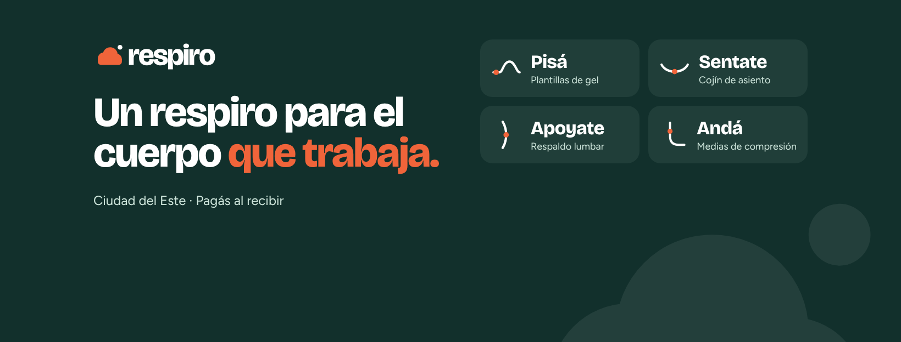

# Respiro

**Un respiro para el cuerpo que trabaja.**

Respiro es una marca de productos de soporte y comodidad para la gente que trabaja jornadas largas, de pie o sentada: vendedores, enfermeros, cocineros, guardias, docentes y oficinistas. Nace en Ciudad del Este, Paraguay.

El nombre habla del beneficio, no del producto: lo que todos buscan al final del turno es un respiro. Por eso la marca puede crecer a cualquier producto que alivie el cuerpo.

## Las líneas

Cada línea tiene un nombre en voseo, como hablamos acá, y un ícono con la curva del cuerpo que sostiene.

| Línea | Producto | Ícono |
|---|---|---|
| **Pisá** | Plantillas de gel y taloneras | `lineas/icono-pisa.svg` (el arco del pie) |
| **Sentate** | Cojín de asiento | `lineas/icono-sentate.svg` (el apoyo al sentarse) |
| **Apoyate** | Respaldo lumbar | `lineas/icono-apoyate.svg` (la curva lumbar) |
| **Andá** | Medias de compresión | `lineas/icono-anda.svg` (la pierna) |

En los productos se escribe **Respiro Pisá**, **Respiro Sentate**, etc. Ejemplo: *Kit Primer Paso de Respiro Pisá*.

## Qué hay en este repo

| Carpeta | Contenido |
|---|---|
| `logo/` | Logo, palabra sola, símbolo e íconos de Respiro en SVG (letras en curvas, no necesitan la fuente instalada) |
| `exports/` | Todo en PNG listo para usar, incluida la portada de Facebook |
| `lineas/` | Íconos de las 4 líneas, y en `lineas/pisa/` el material de la línea de plantillas |
| `fuentes/` | Bricolage Grotesque y Figtree, con su licencia libre (OFL) |

## Logo

**El símbolo es una nube de aire:** el soplo que soltás cuando por fin te sentás o te sacás los zapatos, con una burbuja de aire que sube. Es blando, liviano y amigable, como tienen que sentirse los productos.

| Archivo | Cuándo usarlo |
|---|---|
| `respiro-logo.svg` | Logo principal, sobre fondos claros |
| `respiro-logo-blanco.svg` | Sobre el verde Tinta o fotos oscuras |
| `respiro-logo-sobre-naranja.svg` | Sobre el naranja Brasa (trae el fondo incluido) |
| `respiro-palabra.svg` / `respiro-palabra-blanco.svg` | Solo la palabra, para espacios horizontales chicos |
| `respiro-simbolo.svg` / `respiro-simbolo-blanco.svg` | Solo la nube, para sellos, etiquetas y bordados |
| `respiro-icono-perfil.svg` | Foto de perfil de Instagram, Facebook y WhatsApp (cuadrado, se recorta en círculo) |
| `respiro-icono-app.svg` | Ícono con esquinas redondeadas (favicon, app) |

**Reglas:**
- La nube siempre va en naranja Brasa. La burbuja va del color de las letras.
- No estirar, inclinar ni cambiar los colores del logo.
- Dejar alrededor un espacio libre de al menos el alto de la burbuja por dos.
- El punto de la "i" va del mismo color que las letras: el naranja es solo de la nube.

## Colores

| Nombre | HEX | Uso |
|---|---|---|
| Tinta | `#12302C` | Base: fondos, textos y la palabra del logo |
| Brasa | `#F0643A` | Acento: la nube, botones y lo que tiene que destacar |
| Aire | `#CFE6DC` | Apoyo: textos secundarios sobre Tinta, ilustraciones, fondos suaves |
| Bruma | `#F3F5F2` | Fondo claro de páginas y piezas |
| Blanco | `#FFFFFF` | Fondo de producto y tarjetas |
| Gris texto | `#4A5F5B` | Textos secundarios sobre fondos claros |

El naranja Brasa no tiene suficiente contraste para textos chicos sobre blanco. Para texto naranja sobre fondo claro usá `#C2481E`. Sobre botones naranjas, el texto va en Tinta.

## Tipografía

- **Bricolage Grotesque ExtraBold:** títulos, ganchos y el logo. Interletrado apretado.
- **Figtree:** textos, precios y botones (Regular, Medium y Bold).

Las dos son gratis y de uso comercial libre. También están en Google Fonts.

## Cómo hablamos

- **Como un vecino, no como un médico.** De vos, simple y en paraguayo.
- **Alivio, soporte y comodidad, nunca "cura".** Prometemos lo que el producto hace.
- **Orgullo de laburar.** Le hablamos a la gente que no para, no a "pacientes".

## Pendientes

- [ ] Buscar "Respiro" en la DINAPI, en las clases 20 (cojines y respaldos) y 25 (medias y plantillas), y registrarla si está libre
- [ ] Rehacer la caja del Kit Primer Paso y los posts con la marca nueva (hoy en `lineas/pisa/` todavía dicen solo "pisá")
- [ ] Actualizar la tienda online con la marca nueva
- [ ] Consultar con el despachante si las medias de compresión necesitan registro en DINAVISA
