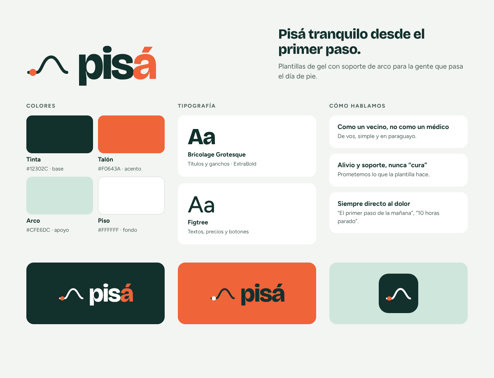
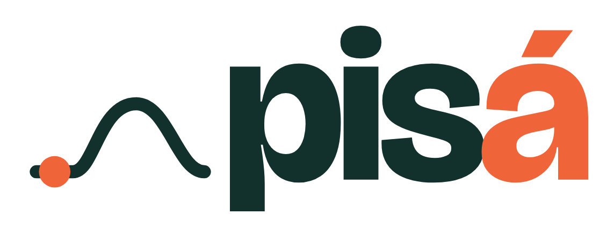
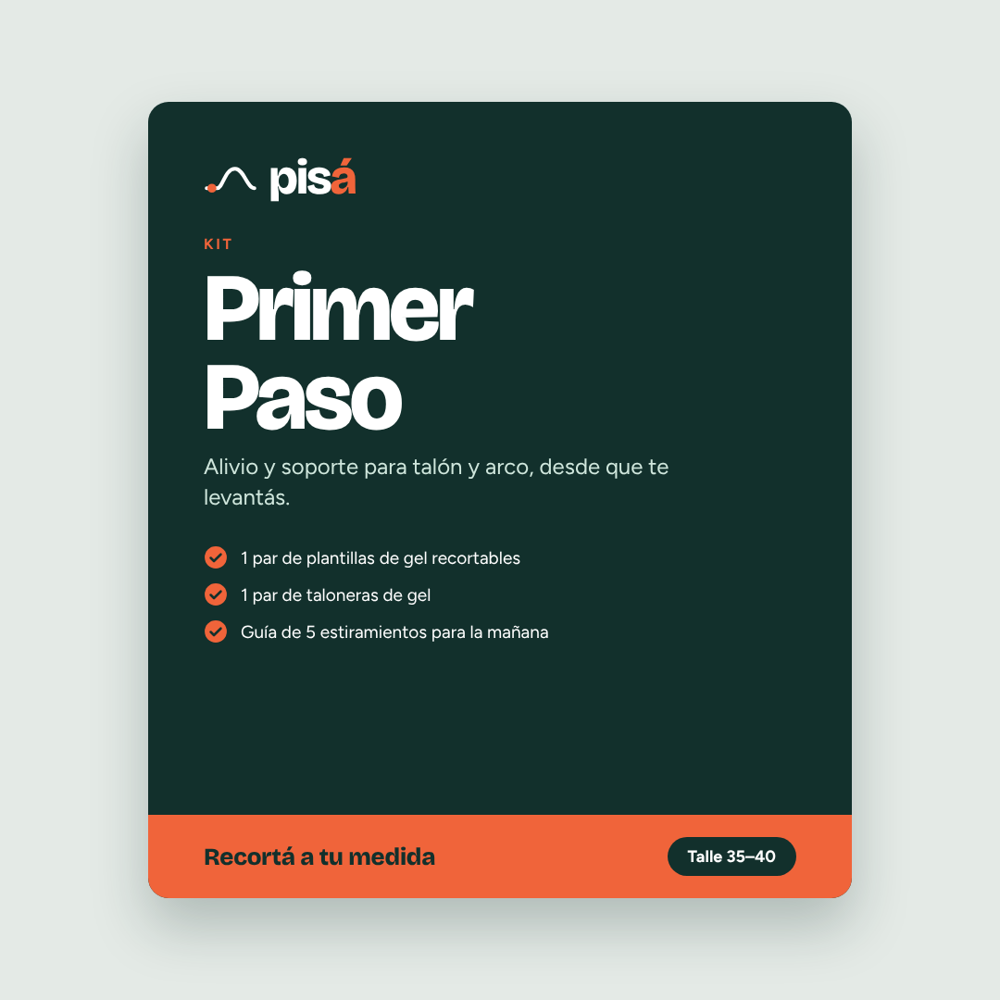
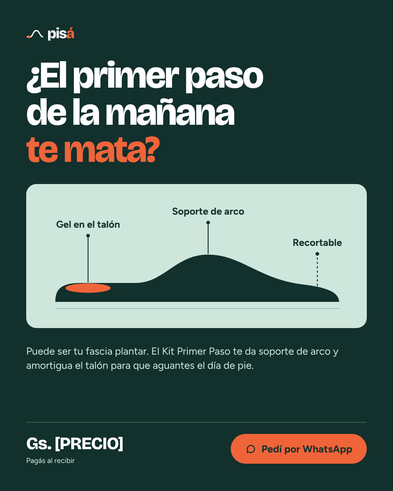

# Pisá

**Pisá tranquilo desde el primer paso.**

Pisá es una marca de plantillas de gel con soporte de arco para la gente que pasa el día de pie. Nace en Ciudad del Este, Paraguay, para resolver un dolor concreto: el talón que molesta desde el primer paso de la mañana.

El nombre es el "pisá" en voseo, como hablamos acá. Una invitación a caminar sin dolor.

## Qué hay en este repo

| Carpeta | Contenido |
|---|---|
| `logo/` | Logo e isotipo en SVG vectorial (las letras ya están convertidas a curvas, no necesitan la fuente instalada) |
| `exports/` | Todo en PNG listo para usar: logos, hoja de marca, caja y post |
| `piezas/` | Las piezas en HTML editable: hoja de marca, caja del kit (dos talles) y post de Instagram |
| `fuentes/` | Bricolage Grotesque y Figtree, con su licencia libre (OFL) |
| `fuente-diseno/` | Archivos originales del lienzo de diseño en Claude |

## Logo

| Archivo | Cuándo usarlo |
|---|---|
| `pisa-logo.svg` | Sobre fondos claros (blanco, menta) |
| `pisa-logo-blanco.svg` | Sobre el verde Tinta o fotos oscuras |
| `pisa-logo-sobre-naranja.svg` | Sobre el naranja Talón (trae el fondo incluido) |
| `pisa-isotipo.svg` / `pisa-isotipo-blanco.svg` | Solo el símbolo, para espacios chicos |
| `pisa-icono-perfil.svg` | Foto de perfil de Instagram y WhatsApp (cuadrado, se recorta en círculo) |
| `pisa-icono-app.svg` | Ícono con esquinas redondeadas |

**El símbolo** es el arco del pie visto de costado. El punto naranja marca el talón, que es donde duele. La "á" naranja repite ese acento.

**Reglas:**
- No estirar, inclinar ni cambiar los colores del logo.
- Dejar alrededor un espacio libre de al menos la altura de la "i".
- El naranja siempre va en la "á" y en el punto del talón, nunca en todo el logo.

## Colores

| Nombre | HEX | Uso |
|---|---|---|
| Tinta | `#12302C` | Base: fondos de cajas y posts, textos |
| Talón | `#F0643A` | Acento: el dolor, la urgencia, botones |
| Arco | `#CFE6DC` | Apoyo: ilustraciones, textos secundarios sobre Tinta |
| Piso | `#FFFFFF` | Fondo claro |
| Gris texto | `#4A5F5B` | Textos secundarios sobre fondos claros |

El naranja Talón no tiene suficiente contraste para textos chicos sobre blanco. Para texto naranja sobre fondo claro usá `#C2481E`. Sobre botones naranjas, el texto va en Tinta.

## Tipografía

- **Bricolage Grotesque ExtraBold**: títulos, ganchos y el logo. Interletrado apretado.
- **Figtree**: textos, precios y botones (Regular, Medium y Bold).

Las dos son gratis y de uso comercial libre. También están en Google Fonts.

## Cómo hablamos

- **Como un vecino, no como un médico.** De vos, simple y en paraguayo.
- **Alivio y soporte, nunca "cura".** Prometemos lo que la plantilla hace.
- **Siempre directo al dolor.** "El primer paso de la mañana", "10 horas parado".

## Piezas

| Caja del Kit Primer Paso | Post de Instagram (4:5) |
|---|---|
|  |  |

**Kit Primer Paso:** 1 par de plantillas de gel recortables, 1 par de taloneras de gel y una guía de 5 estiramientos para la mañana. Talles 35–40 y 40–46.

## Cómo editar las piezas

Abrí cualquier archivo de `piezas/` en el navegador para verlo. Para cambiar textos, editá el HTML (por ejemplo, reemplazá `[PRECIO]` en el post). Las piezas usan las fuentes de la carpeta `fuentes/`, así que se ven bien sin internet.
